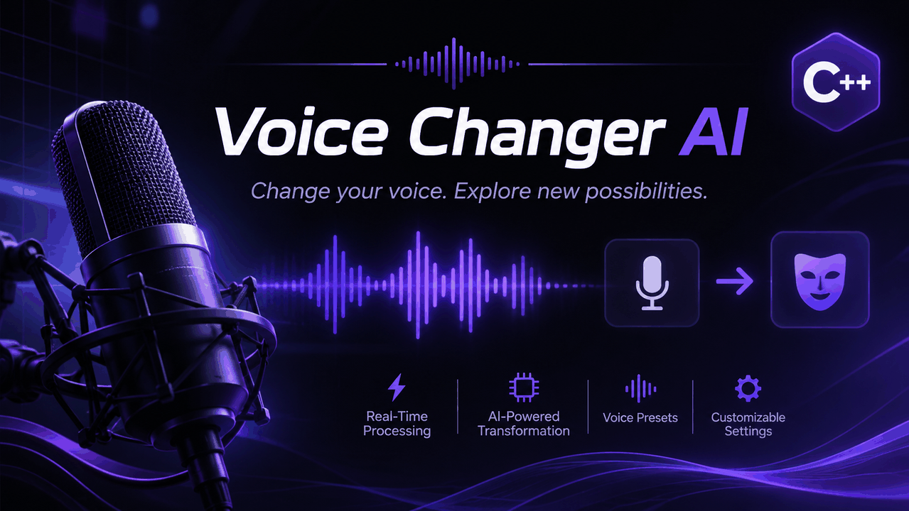

  

🎙️ Voice Changer

Voice Changer is a real-time voice transformation application that lets you modify your microphone input and create unique voice effects. Whether you want to sound completely different, experiment with audio filters, or simply have fun with voice transformations, this application provides the tools to customize your voice.

✨ Features

Real-Time Voice Changing — Transform your voice instantly while speaking, without needing to record audio first.

Multiple Voice Effects — Experiment with different voice styles, tones, pitches, and sound modifications.

Custom Audio Settings — Fine-tune your voice using adjustable audio parameters and effects.

Microphone Support — Use your connected microphone as the primary audio input.

Live Audio Processing — Hear your modified voice with minimal delay.

Easy-to-Use Interface — Simple and intuitive controls make voice customization accessible to everyone.

Customizable Experience — Adjust settings to achieve the sound you want.

🎧 What Can You Do?

Change your voice in real time.

Create unique and funny voice effects.

Experiment with different pitches and tones.

Customize your microphone audio.

Use voice effects in voice chats and other applications (if supported by your audio routing setup).

🚀 Getting Started

Download or clone the repository.

Install the required dependencies.

Launch the application.

Select your microphone and configure your audio settings.

Choose your preferred voice effect and start talking!

🛠️ Technologies

Built with modern tools and technologies for audio processing and real-time voice manipulation.

📌 Project Status

This project is actively being developed. New features, improvements, and additional voice effects may be introduced in future updates.

📄 License

See the repository for license information.
